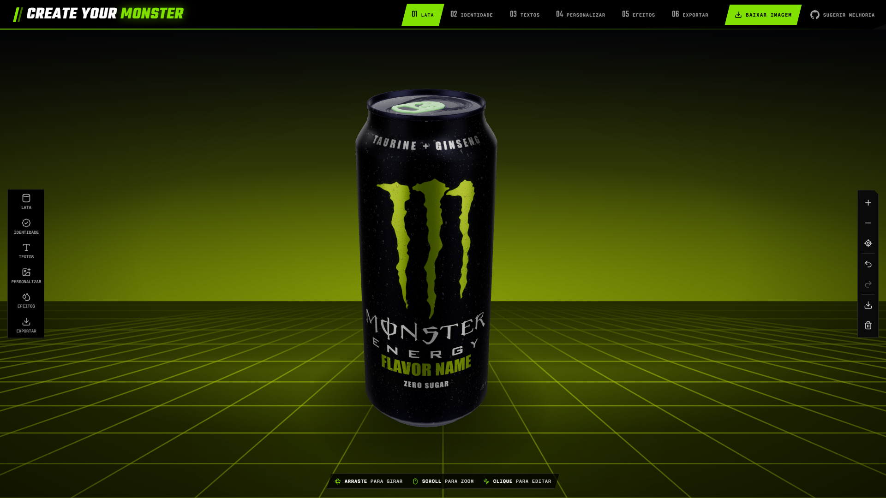
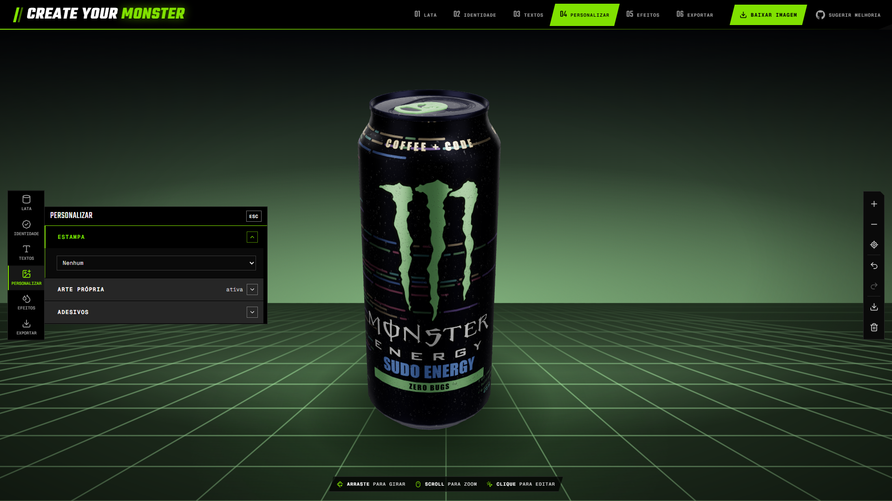
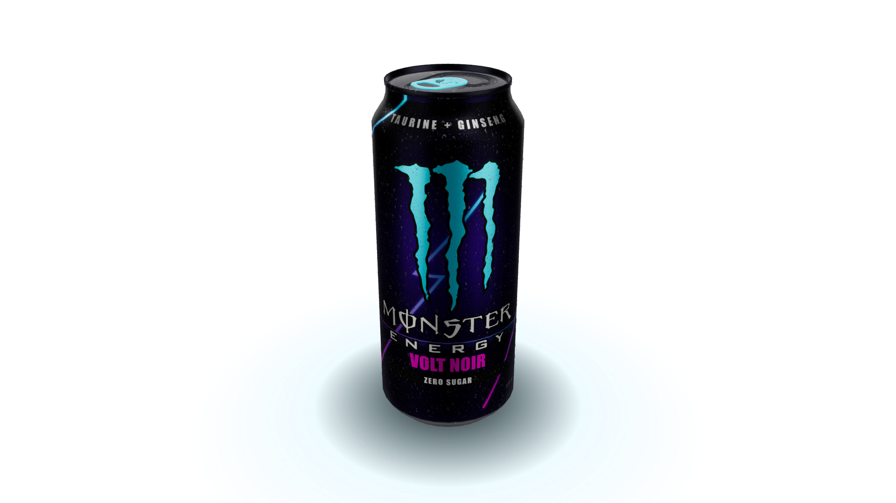
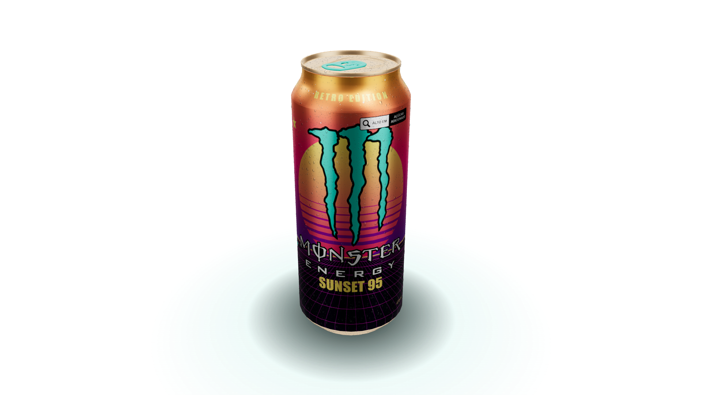

# Create Your Monster — Sua lata, suas regras

Configurador 3D de lata em tempo real. Você parte de uma lata neutra e monta a sua própria versão: cor, logo, textos, adesivos, padrões, ombro, lacre e mais, com feedback visual imediato.

**[Testar online → createyourmonster.vercel.app](https://createyourmonster.vercel.app/)**

> Projeto conceitual e **não oficial**, feito para portfólio pessoal. Não tem vínculo com a Monster Energy.



## O que dá pra fazer

- Personalizar o corpo da lata (cor, preenchimento, padrões e acabamentos)
- Adicionar textos, adesivos e arte própria
- Customizar o ombro e o lacre (incluindo logo no lacre)
- Efeito de condensação (lata gelada) e rótulo de sabor
- Editar pelo painel ou clicando direto nas partes do modelo 3D
- Desfazer / refazer alterações
- Escolher o fundo do palco e exportar imagem da lata
- Layout adaptado para desktop e mobile (bottom sheet), com ajuste automático de qualidade

## Exemplos

| Arte personalizada | Volt Noir | Retro Sunset |
| --- | --- | --- |
|  |  |  |

## Stack

- [React 19](https://react.dev) + TypeScript
- [Vite](https://vite.dev)
- [Three.js](https://threejs.org) via [@react-three/fiber](https://r3f.docs.pmnd.rs) e [drei](https://drei.docs.pmnd.rs)
- [Tailwind CSS 4](https://tailwindcss.com)
- [Motion](https://motion.dev) para animações
- [lucide-react](https://lucide.dev) para ícones
- [oxlint](https://oxc.rs) para lint

## Como rodar

Requer Node.js 20+.

```bash
npm install
npm run dev
```

Abre em `http://localhost:5173`.

| Comando | O que faz |
| --- | --- |
| `npm run dev` | Servidor de desenvolvimento |
| `npm run build` | Checagem de tipos (`tsc -b`) e build de produção em `dist/` |
| `npm run preview` | Serve o build localmente |
| `npm run lint` | Roda o oxlint |

## Estrutura

```
public/models/   Modelo 3D da lata (monster-can.glb)
src/
  App.tsx        Composição da aplicação
  components/    Viewer 3D, painéis do editor, controles e lógica de textura da lata
  cursors.ts     Cursores customizados
tests/           Testes de lógica da lata (wrap, interação, camadas de arte)
```

A lata é desenhada em camadas de canvas (`can*.ts`) que viram textura aplicada ao modelo GLB. Os `*DevControls` são painéis de ajuste fino usados no desenvolvimento.

## Roadmap e ideias

- [create-your-monster-roadmap.md](create-your-monster-roadmap.md): visão do produto e plano de desenvolvimento
- [IDEAS.md](IDEAS.md): backlog de ideias

## Contribuindo

Sugestões são bem-vindas pelo template de issue em [.github/ISSUE_TEMPLATE](.github/ISSUE_TEMPLATE).
